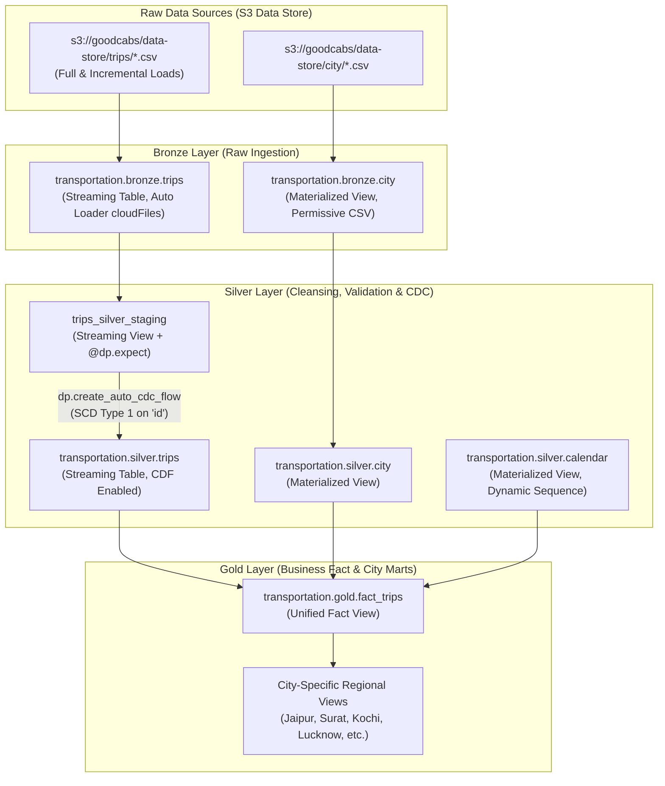

# Goodcabs Transportation Lakehouse: Streaming Ingestion & Declarative CDC Pipeline

[](https://databricks.com/)
[](https://spark.apache.org/)
[](https://delta.io/)
[](https://python.org)
[](https://spark.apache.org/sql/)

An end-to-end, production-grade **Medallion Lakehouse** architecture built for **Goodcabs**—a fast-growing cab service operating across Tier-2 cities in India. This project demonstrates modern declarative data engineering on **Databricks** utilizing **Spark Declarative Pipelines (Delta Live Tables / Lakeflow)**, **Databricks Auto Loader**, **Automated Change Data Capture (CDC / SCD Type 1)**, **Data Quality Expectations**, and **Change Data Feed (CDF)**.

---

## Architecture Overview

The pipeline ingests raw operational trip batches and master reference data from AWS S3, cleanses and validates records through streaming quality gates, applies automated SCD Type 1 upserts to maintain current ride status, and serves curated dimensional models for city-specific business analytics.


### Medallion Pipeline Flow



---

## Medallion Architecture Breakdown

### 1. Bronze Layer (Raw Landing & Schema Safety)
* **City Master (`transportation.bronze.city`):** Ingested as a `@dp.materialized_view` with permissive CSV parsing (`mode="PERMISSIVE"`, `columnNameOfCorruptRecord="_corrupt_record"`). Enriched with ingestion metadata (`file_name`, `ingest_datetime`).
* **Trip Orders (`transportation.bronze.trips`):** Ingested incrementally using **Databricks Auto Loader** (`spark.readStream.format("cloudFiles")`). 
  * `cloudFiles.inferColumnTypes = true` for automated schema discovery.
  * `cloudFiles.schemaEvolutionMode = rescue` to automatically route unanticipated or corrupt schema drift into a `_rescued_data` column without halting the ingestion stream.
  * Column cleansing: Safely normalizes problematic column headers (e.g., `distance_travelled(km)` to `distance_travelled_km`).

### 2. Silver Layer (Quality Gates, Dimensions & Declarative CDC)
* **Data Quality Gates (`@dp.expect`):** The staging view `trips_silver_staging` enforces business rules declaratively:
  * `valid_date`: `year(business_date) >= 2020`
  * `valid_driver_rating`: `driver_rating BETWEEN 1 AND 10`
  * `valid_passenger_rating`: `passenger_rating BETWEEN 1 AND 10`
* **Dynamic Calendar Dimension (`transportation.silver.calendar`):** Generates a continuous daily sequence using `explode(sequence(start_date, end_date))` enriched with:
  * Calendar keys (`yyyyMMdd`), Year, Quarter, Month, Week of Year, Day of Week.
  * Weekend/Weekday flags (`is_weekend`, `is_weekday`).
  * Indian National Holiday detection (`Republic Day`, `Independence Day`, `Gandhi Jayanti`).
* **Automated CDC Upsert (`dp.create_auto_cdc_flow`):**
  * Target: `transportation.silver.trips` streaming table with `delta.enableChangeDataFeed = true`.
  * Merges incoming updates on Primary Key `keys=["id"]`.
  * **Out-of-order resolution**: Uses `sequence_by=F.col("silver_processed_timestamp")` to ensure delayed or re-delivered records never overwrite newer state.
  * **SCD Type 1**: Maintains current state in-place for fast downstream querying while retaining delta auditability.

### 3. Gold Layer (Analytics Mart & City Partitioning)
* **Unified Fact View (`transportation.gold.fact_trips`):** Joins `silver.trips` with `silver.city` and `silver.calendar`, producing an analytics-ready dimensional model with normalized timestamps, passenger categories, fare amounts, ratings, and holiday flags.
* **City-Specific Mart Views:** Optimized regional views filtering by `city_id` for localized operational teams:
  * `fact_trips_jaipur` (`RJ01`)
  * `fact_trips_surat` (`GJ01`)
  * `fact_trips_chandigarh` (`CH01`)
  * `fact_trips_lucknow` (`UP01`)
  * `fact_trips_kochi` (`KL01`)
  * `fact_trips_indore` (`MP01`)
  * `fact_trips_vadodara` (`GJ02`)
  * `fact_trips_visakhapatnam` (`AP01`)
  * `fact_trips_coimbatore` (`TN01`)
  * `fact_trips_mysore` (`KA01`)

---

## Key Technical Learnings & Best Practices

1. **Inversion of Control in Declarative Pipelines:**
   * Traditional Spark pipelines require imperative boilerplate: managing `writeStream`, configuring checkpoint directories, and coordinating Airflow tasks.
   * Spark Declarative Pipelines (`dp`) invert control: you write pure transformation functions returning DataFrames; the platform derives dependencies, generates the DAG, coordinates streaming state checkpoints, and handles retries.
2. **Streaming Views vs Streaming Tables:**
   * Intermediate transformations (such as data type casting and expectation checking) are kept in `@dp.view` (in-memory, zero storage overhead).
   * Persisted datasets use `@dp.table` or `dp.create_streaming_table` for persistent Delta storage.
3. **Change Data Feed (CDF) for Downstream Consumers:**
   * Setting `delta.enableChangeDataFeed: "true"` on the Silver streaming table allows future Gold aggregations to consume incremental row-level mutations rather than scanning full snapshots.
4. **Resilient Schema Evolution with Auto Loader:**
   * Using `cloudFiles.schemaEvolutionMode = "rescue"` guarantees zero data loss when upstream data providers add unexpected columns or corrupt fields.

---

## Repository Structure

```text
.
├── 1. data/
│   ├── city/
│   │   └── city.csv                   # Master city dimension (10 Tier-2 cities)
│   └── trips/
│       ├── Full Load/                 # Historical daily trip files (Aug 2025 - Dec 2025)
│       └── Incremental Load/          # Delta incremental batch files
├── 2. codes/
│   ├── project_setup.ipynb            # Unity Catalog & schema setup notebook
│   ├── bronze/
│   │   ├── city.py                    # Bronze city dimension ingestion
│   │   └── trips.py                   # Bronze streaming trips ingestion (Auto Loader)
│   ├── silver/
│   │   ├── city.py                    # Silver city dimension transformation
│   │   ├── calendar.py                # Silver dynamic calendar dimension
│   │   └── trips.py                   # Silver trips view, expectations & CDC flow
│   └── gold/
│       ├── trips_gold.sql             # Unified Gold fact view
│       ├── trips_jaipur.sql           # Jaipur regional mart
│       ├── trips_surat.sql            # Surat regional mart
│       ├── trips_kochi.sql            # Kochi regional mart
│       └── trips_*.sql                # Remaining city-specific SQL views
├── 3. other_files/
│   └── architecture.png               # High-resolution architectural blueprint
└── README.md                          # Project documentation and guide
```

---

## Setup & Deployment Guide

### Prerequisites
* Databricks Runtime 13.3+ LTS or Databricks Lakeflow / Delta Live Tables environment.
* Unity Catalog enabled workspace with permissions to create catalogs/schemas.
* AWS S3 bucket or DBFS storage location configured for storage credentials.

### Step 1: Initialize Unity Catalog & Schemas
Run `2. codes/project_setup.ipynb` in your Databricks workspace:
```python
# Creates catalog and medallion schemas
spark.sql("CREATE CATALOG IF NOT EXISTS transportation")
spark.sql("CREATE SCHEMA IF NOT EXISTS transportation.bronze")
spark.sql("CREATE SCHEMA IF NOT EXISTS transportation.silver")
spark.sql("CREATE SCHEMA IF NOT EXISTS transportation.gold")
```

### Step 2: Configure Pipeline Settings
In your Databricks pipeline configuration:
* **Source Code:** Add paths to `2. codes/bronze`, `2. codes/silver`, and `2. codes/gold`.
* **Target Catalog:** `transportation`
* **Configuration Parameters:**
  ```json
  {
    "start_date": "2025-01-01",
    "end_date": "2025-12-31"
  }
  ```

### Step 3: Run the Pipeline
1. **Initial Full Load:** Trigger pipeline run with the files in `1. data/trips/Full Load`.
2. **Incremental Batch Verification:** Drop files from `1. data/trips/Incremental Load` into the source location and execute an incremental update to observe the Auto Loader trigger and SCD Type 1 upsert flow in real time.

---

## Author

**Aravindan Rameshbabu**  
Senior Data & AI Engineer  
- **GitHub:** [@arv1ndofficial](https://github.com/arv1ndofficial)  
- **LinkedIn:** [linkedin.com/in/aravindanramesh](https://www.linkedin.com/in/aravindanramesh/)  
- **Portfolio:** [arv1ndofficial.github.io](https://arv1ndofficial.github.io)
